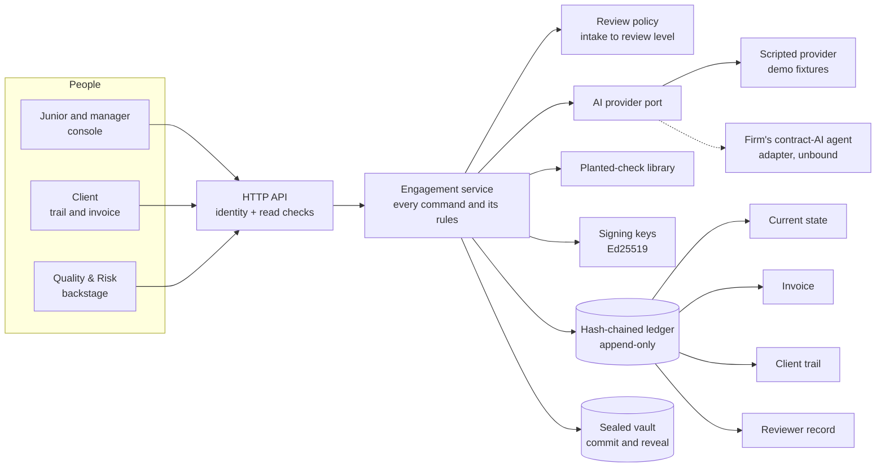

# Countersign

**The human-judgment layer for AI-assisted advisory work.** Every step the AI takes is decided, reasoned and signed by a named person, and the signed milestone is what the client pays for.

Built at the UZH.ai Business–Academia Hackathon 2026 for **KPMG Challenge 3: what is the billable unit when AI agents do the work?**


## The problem

AI compresses a 40-hour contract review into a few hours. Under hourly billing, revenue on that job falls about 70%, and the hours that remain are the ones a junior can skip by clicking "approve" on whatever the AI says. Firms need a unit of value that does not shrink as the AI improves, and evidence that a person actually exercised judgment.

## The answer: bill the signature, not the hour

One record, three readers:

| The record holds | Billing reads it as | The client reads it as | Quality & Risk reads it as |
|---|---|---|---|
| Each AI proposal, each human decision with its reason, and a signature per milestone | One invoice line per signed milestone, at a published rate | A one-page trail: who checked what, who signed, and proof nothing was edited afterwards | Evidence for staff evaluation: planted checks caught, blind-pass recall, reasons given |

For the Alpina Pumps case (fictional), the full review is quoted at **CHF 7,200** against **CHF 10,000** billed by the hour before AI. The client pays 28% less, and KPMG's margin rises because its cost falls faster than its price ([pricing](docs/pricing.md)).

## How it keeps the human in the loop

| Jury concern | Mechanism | Where |
|---|---|---|
| "Juniors might use AI to skip the work" | **Blind first pass**: in risk screening the AI's list is sealed (a hash is published) until the junior submits their own risks. The gap becomes a learning record. | [`services/engagements.py`](src/countersign/services/engagements.py), [ADR 2](docs/adr/0002-blind-first-pass-commit-reveal.md) |
| | **Planted checks**: plausible but false AI findings mixed into the output. Approving one blocks the signature and escalates the step to the manager. | [`ai/controls.py`](src/countersign/ai/controls.py), [ADR 3](docs/adr/0003-planted-checks.md) |
| | Rejections and rewrites need a reason (tick-box or text). There is no bulk approve. Approvals under 4 seconds are surfaced. | [`domain/models.py`](src/countersign/domain/models.py) |
| "Who decides the price? Bias?" | A **published rate card**, locked when the engagement opens. Price = milestone rate × review-level multiplier. No outcome-contingent fees. | [`config/rate_card.toml`](src/countersign/config/rate_card.toml) |
| "Accountability" | **Ed25519 signature per milestone** over a digest of every item, decision and the ledger head. The final report is signed by the manager. | [`ledger/crypto.py`](src/countersign/ledger/crypto.py) |
| "Can the record be trusted?" | **Append-only, hash-chained ledger**. The database refuses edits; edits made around it are detected and located. | [`ledger/store.py`](src/countersign/ledger/store.py), [ADR 1](docs/adr/0001-hash-chained-event-ledger.md) |
| "Which part are you addressing?" | Each milestone has a **lane** that states who leads: AI-led with spot checks, AI drafts and a person confirms, human-led blind, AI drafts and a person edits, human-led. | [`domain/workflow.py`](src/countersign/domain/workflow.py) |
| "Competition" | The model is a pluggable port. What a legal-tech startup cannot copy is a signed professional judgment backed by the firm's benchmark data and liability. | [`ai/provider.py`](src/countersign/ai/provider.py) |

## Quick start

Requires Python 3.11+.

```bash
pip install -e ".[dev]"

make demo     # replay the whole Alpina case in the terminal, then tamper with it
make serve    # console at http://localhost:8000, seeded just before the blind pass
make test     # 43 tests
```

In the console, switch people with **Acting as** (junior, manager, client, Quality & Risk) and rewind with **Demo → Reset to stage**. The [demo script](docs/demo-script.md) is a three-minute click path for the pitch.

## Screens

| Blind first pass: the AI's list is sealed | The client's one-page trail | Quality & Risk: reviewer record and raw ledger |
|---|---|---|
|  |  |  |

AI output is shown in graphite and every human act in signing-ink blue, so it is always visible who said what.

## Architecture



Every state change is an event in the ledger; state, invoice, client trail and reviewer metrics are all derived from it. Details, the event catalogue and the rule-to-test map are in [docs/architecture.md](docs/architecture.md).

```
src/countersign/
  domain/        roles, lanes, review policy, workflow templates, events
  ledger/        hash-chained event store, commitments, signatures
  ai/            provider port, scripted provider, planted-check library
  services/      commands and their invariants
  projections/   state, invoice, client trail, reviewer record, blind-pass gap
  api/           FastAPI app and JSON views
  web/           consultant console (no build step)
fixtures/alpina_sinogear/   the fictional contract, AI outputs, planted checks, risk taxonomy
tests/                      unit, end-to-end scenario and API tests
docs/                       architecture, pricing, ADRs, demo script
```

## Assumptions and what is not built

Stated openly, because the jury asked for visible assumptions:

- **AI output is scripted.** The fixtures stand in for the firm's contract-AI agent; [`ContractAgentAdapter`](src/countersign/ai/provider.py) marks where it binds. No client data leaves the firm's environment in the intended design.
- **Identity is a stand-in** (`X-User` header). Production uses the firm's SSO; the rules live in the service layer and do not change.
- **Signing keys are derived from user ids** for a reproducible demo. Production keys live in the firm's PKI or an HSM, or a qualified e-signature service under Swiss ZertES.
- **Rate-card numbers are illustrative.** Calibrating them from historical timesheets is a hypothesis to validate with KPMG's own data.
- **Reviewer metrics are personal data** under the Swiss FADP. Using them in evaluations needs a published policy, and staff should know planted checks exist (not where).
- **One SQLite file.** The same append-only, hash-chained design ports to Postgres; periodic anchoring of the chain head (e.g. in the client's copy of the trail) would add external proof.
- **The Classic (hourly) tier** stays in the firm's existing time-and-billing system.
- All companies, people and figures are fictional. Nothing here is legal advice.

## License

MIT. See [LICENSE](LICENSE).
