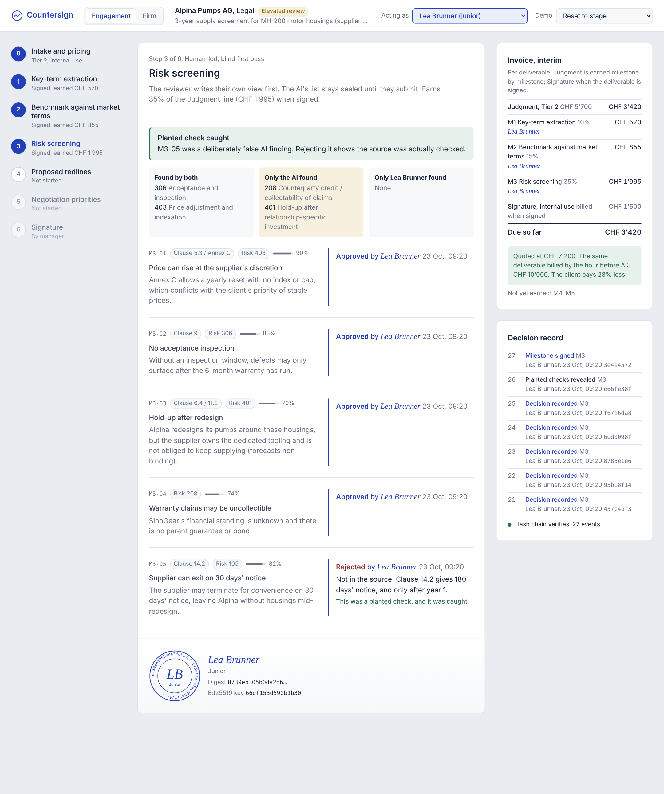
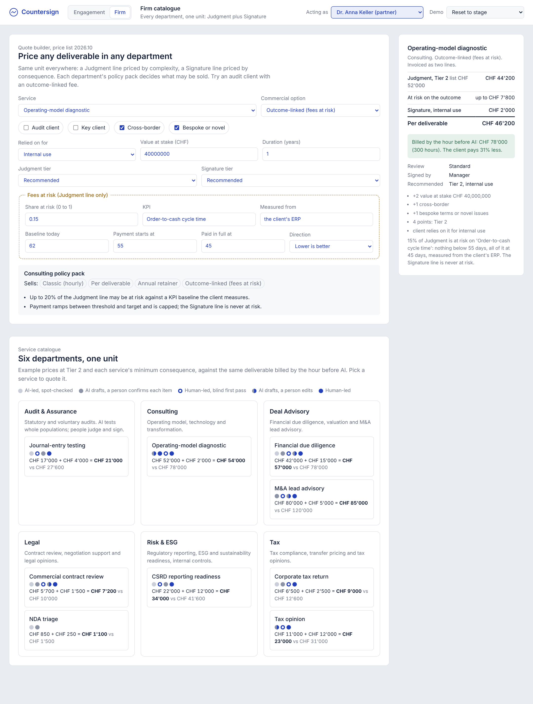
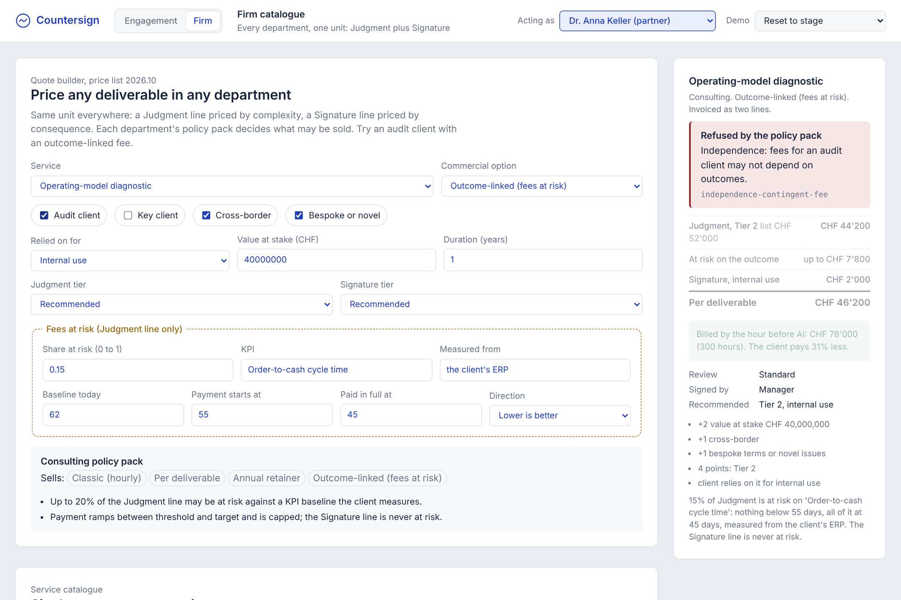
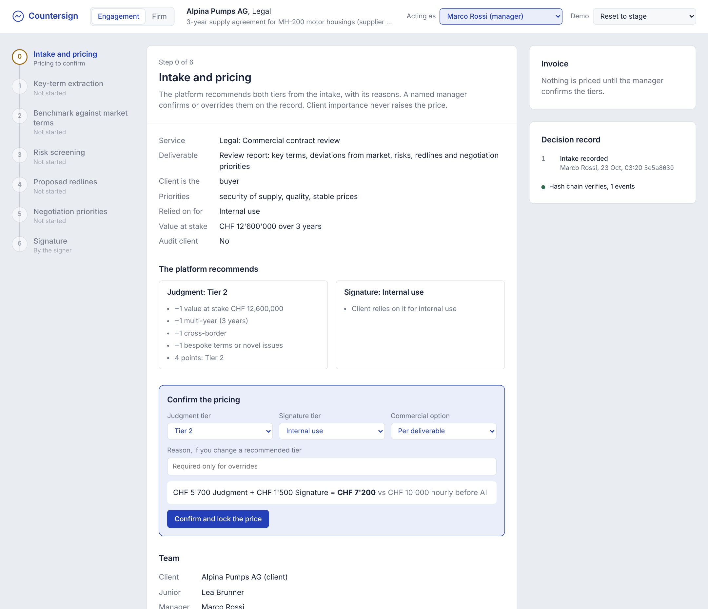
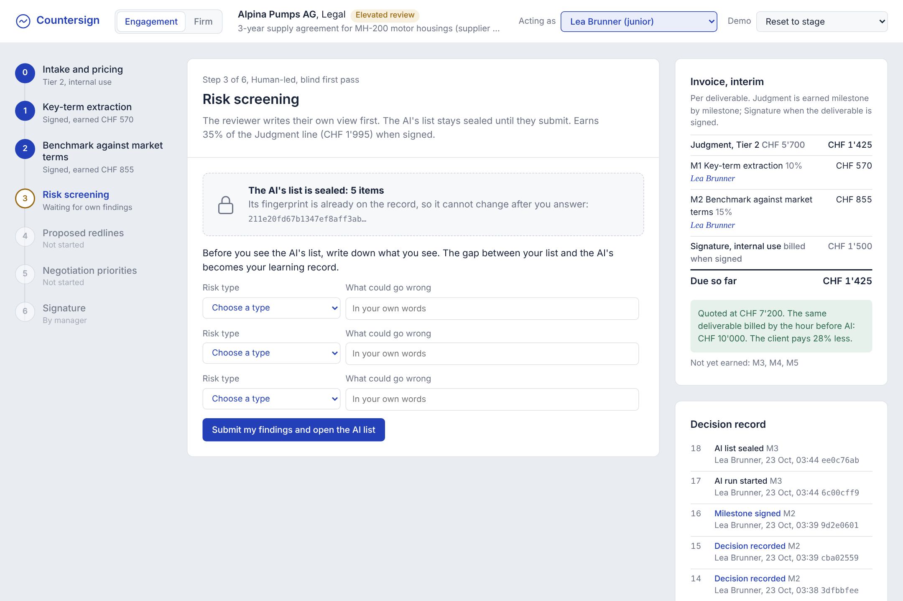
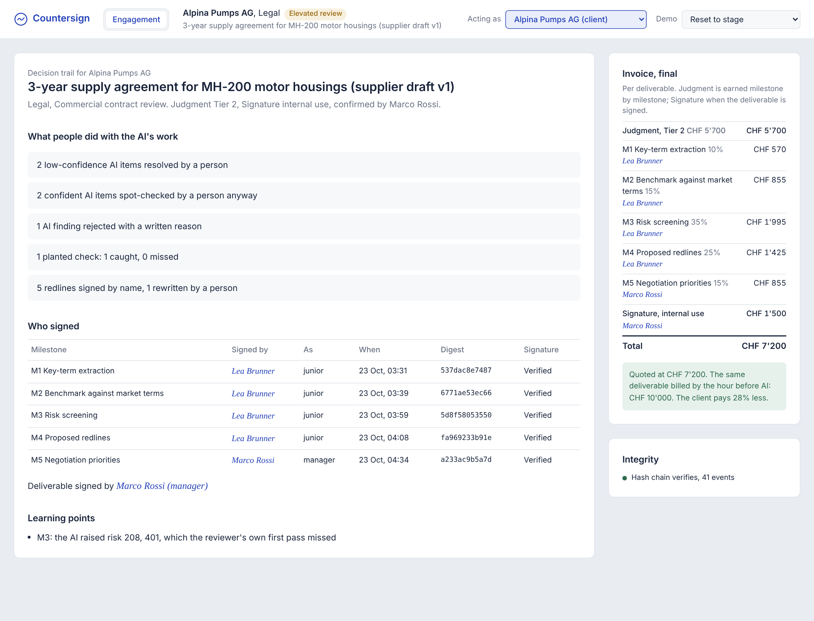
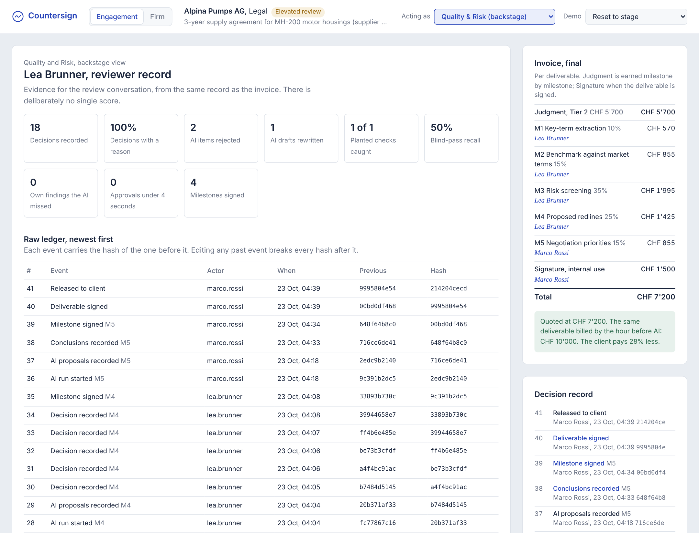
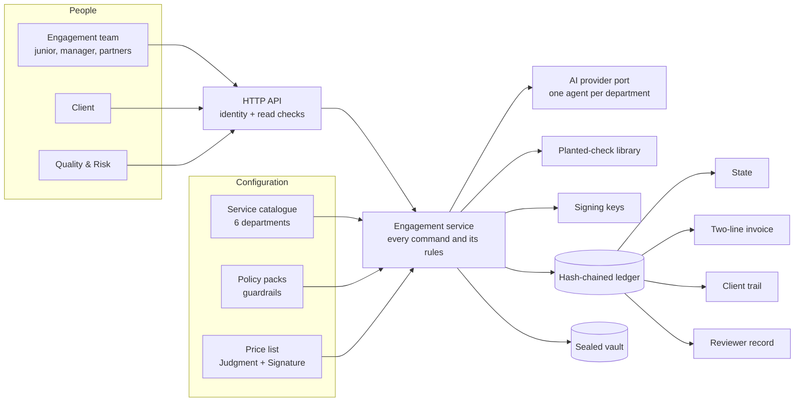

# Countersign

**An operating system for signed judgment across KPMG.** AI does the production work in every department; a named person decides, gives a reason and signs. Every deliverable is billed in two lines, **Judgment** and **Signature**, instead of hours.

Built at the UZH.ai Business–Academia Hackathon 2026 for **KPMG Challenge 3: what is the billable unit when AI agents do the work?**



## The problem

AI compresses a 40-hour contract review, a 184-hour tax opinion or a due-diligence data-room sweep into a fraction of the time. Under hourly billing, revenue falls with every efficiency gain, in **every** department. And the hours that remain are the ones a junior can skip by clicking "approve" on whatever the AI says.

## The answer: one unit across the firm

Every deliverable, in every department, is priced the same way (the convergence model):

| Line | What the client pays for | Priced by |
|---|---|---|
| **Judgment** | What people reviewed, challenged, changed and added. The AI's research and drafting are included, never billed separately. | Complexity: Tier 1, 2 or 3 |
| **Signature** | A named person signs, and KPMG carries the liability. | Consequence of error: internal use, external reliance, regulatory |

Judgment is **earned milestone by milestone** as each step is signed, so a client can stop after any step and pay only for what was signed. Signature is billed once, when the deliverable is signed by the people its consequence requires.

The other commercial options are variations of the same two lines, and each department's **policy pack** decides which it may sell:

| Option | How it works | Allowed in |
|---|---|---|
| Per deliverable | Judgment + Signature | Legal, Tax, Deal Advisory, Consulting, Risk & ESG |
| Retainer | A year of deliverables at a discount; each draws one credit | Legal, Tax, Consulting, Risk & ESG |
| Client platform | The client's team prepares in KPMG's AI; KPMG reviews and signs (Judgment × 0.55) | Not for audit clients |
| Fees at risk | Up to 20% of **Judgment** depends on a measured KPI, with a ramp and a cap. Signature is never at risk. | Consulting, M&A lead advisory. Never audit, audit clients, or reports others rely on |
| Engagement fee | Audit: a fixed fee to the client; the two lines are an internal measure | Audit |
| Classic | Hourly, as today, outside the platform | Clients who want it |

**Examples** (illustrative price list, Tier 2):

| Deliverable | Judgment + Signature | Billed hourly before AI |
|---|---|---|
| Alpina supply contract review (Legal, internal use) | 5,700 + 1,500 = **CHF 7,200** | CHF 10,000 |
| Tax opinion (Tax, Tier 3, external reliance), as in our deck | 24,500 + 12,000 = **CHF 36,500** | CHF 51,800 |
| Financial due diligence (Deal Advisory, external reliance) | 42,000 + 15,000 = **CHF 57,000** | CHF 78,000 |

All nine services across six departments are in [docs/departments.md](docs/departments.md), generated from the same configuration the platform enforces.

## Screens

| Firm view: every department, one unit | Guardrail: an audit client cannot have outcome-linked fees |
|---|---|
|  |  |
| **Pricing:** the platform recommends, a named manager confirms | **Blind first pass:** the AI's list is sealed |
|  |  |
| **Client:** the one-page trail | **Quality & Risk:** reviewer record and raw ledger |
|  |  |

AI output is shown in graphite and every human act in signing-ink blue, so it is always visible who said what.

## How the human stays in the loop

| Jury concern | Mechanism |
|---|---|
| "Juniors might use AI to skip the work" | **Blind first pass:** the AI's list is sealed (only its hash is published) until the reviewer submits their own findings. **Planted checks:** plausible but false AI findings; approving one blocks the signature and escalates to the manager. Rejections need a reason; there is no bulk approve; approvals under 4 seconds are surfaced. |
| "Who decides the price? Bias?" | The platform **recommends** tiers from published rules and shows its reasons. A **named manager confirms** or overrides, with a written reason, on the record. Client importance never raises the price. The quote is locked into the ledger. Quality & Risk sees every override. |
| "Accountability" | An **Ed25519 signature** per milestone and per deliverable, over a digest of every decision and the ledger head. Who signs follows the consequence: manager, partner, or partner plus a second partner for regulatory work. |
| "Can the record be trusted?" | An **append-only, hash-chained ledger**. The database refuses edits; edits made around it are detected and located. |
| "People" | Staff must be **certified** to lead AI-assisted work; uncertified juniors stay on Classic work. Promotion evidence comes from the record (planted checks caught, blind-pass recall, reasons given), with no single score. |
| "Competition" | The model is a pluggable port per department. What a legal-tech startup cannot copy is a signed professional judgment backed by KPMG's benchmark data and liability. |
| "Disruptive" | Hours stop being the unit. Revenue follows signed judgment and liability, so AI efficiency raises margin instead of cutting revenue. |

## Quick start

Requires Python 3.11+.

```bash
pip install -e ".[dev]"

make demo     # replay the Alpina case in the terminal, then tamper with the record
make serve    # console at http://localhost:8000, Alpina seeded just before the blind pass
make test     # 92 tests, including one deliverable through every service in every department
```

In the console:
- **Engagement** tab: the Alpina case, step by step. Switch people with **Acting as**; rewind with **Demo → Reset to stage**.
- **Firm** tab: the catalogue of all six departments and a quote builder that applies each policy pack live.

The [demo script](docs/demo-script.md) is a three-minute click path for the pitch.

## Architecture



One engagement, one record:

```
open (intake)  ->  confirm pricing (named manager, guardrails, quote locked)
               ->  milestones: run AI, blind pass, decide with reasons, sign   = Judgment, earned per step
               ->  sign the deliverable (signers by consequence)              = Signature
               ->  (fees at risk) record the measured outcome
```

Details, the event catalogue and the rule-to-test map: [docs/architecture.md](docs/architecture.md). Pricing: [docs/pricing.md](docs/pricing.md). Decisions: [docs/adr](docs/adr).

```
src/countersign/
  config/catalogue/   one TOML per department: services, milestones, policy pack
  config/             price list, people
  domain/             vocabulary, catalogue, policy (tiers, review, signers), guardrails, pricing, events
  ledger/             hash-chained event store, commitments, signatures
  ai/                 provider port, scripted provider, planted-check library
  services/           every command and its rules
  projections/        state, two-line invoice, client trail, reviewer record, blind-pass gap
  api/  web/          FastAPI app and the console
fixtures/alpina_sinogear/   the fictional contract, AI outputs, planted checks, risk taxonomy
tests/                      unit, policy, pricing, lifecycle, end-to-end and API tests
```

## Assumptions and what is not built

Stated openly, because the jury asked for visible assumptions:

- **Legal is the working example.** All six departments are fully configured, priced and guarded, and every service runs end to end in the tests. Only contract review has scripted AI output; the other services need their department's agent bound to [`FirmAgentAdapter`](src/countersign/ai/provider.py).
- **Prices are illustrative.** Anchoring them on historical fees and hours per tier is a hypothesis to validate with KPMG's own billing data.
- **Identity is a stand-in** (`X-User` header). Production uses the firm's SSO and learning records; the rules live in the service layer.
- **Signing keys are derived from user ids** for a reproducible demo. Production keys live in the firm's PKI or an HSM, or a qualified e-signature service under Swiss ZertES.
- **Independence rules are simplified** to the checks a policy pack can make (audit client flag, service type). Real independence clearance stays with Quality & Risk.
- **Reviewer metrics are personal data** under the Swiss FADP. Using them in evaluations needs a published policy, and staff should know planted checks exist (not where).
- **One SQLite file.** The same append-only, hash-chained design ports to Postgres; anchoring the chain head in each client deliverable adds external proof.
- All companies, people and figures are fictional. Nothing here is legal, tax or audit advice.

## License

MIT. See [LICENSE](LICENSE).
